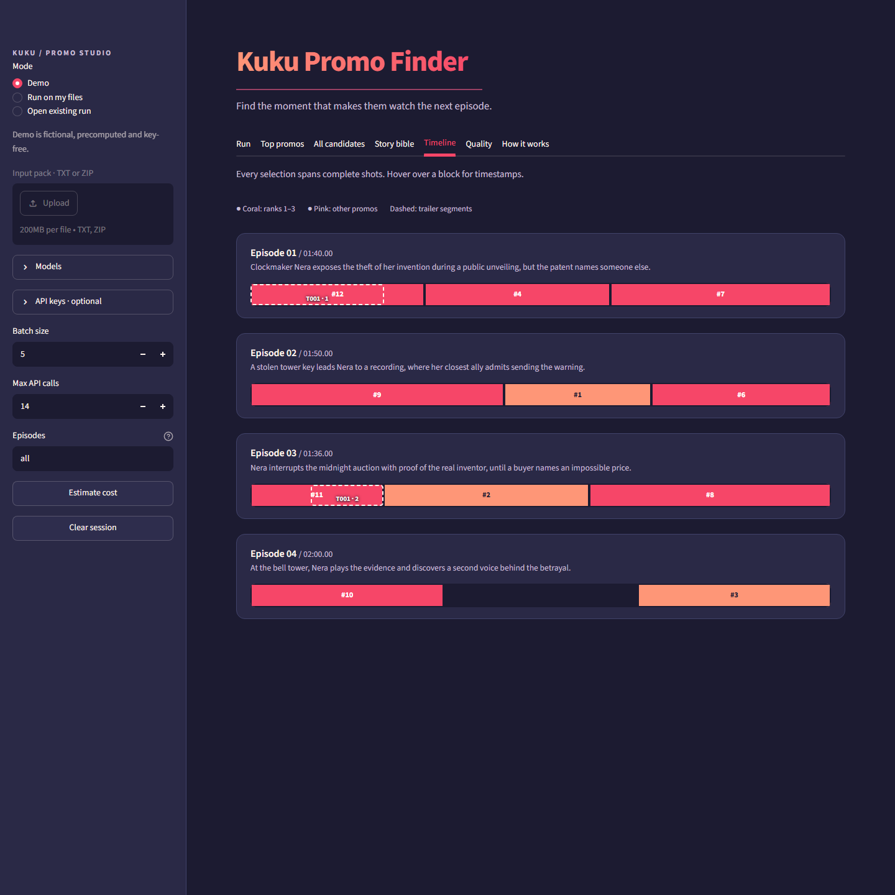

# Kuku Promo Finder

A screenplay-to-promo workbench for short vertical dramas. It proposes continuous
shot ranges, checks timing and boundaries, scores the final clips independently,
and gives an editor a ranked shortlist. Python 3.11+; pydantic v2.

## For reviewers

[Open the live app](https://kuku-promo-finder-27.streamlit.app)

- **Demo** browses a fictional show with precomputed results. No API keys needed.
- **Run on my files** generates promos from your own episode scripts.
- **Load results bundle (.zip)** opens a saved run read-only. No API keys needed.

**Full 50-episode results** — Download `raw_outputs.zip` from the private link in the submission form → open the app → choose **Load results bundle (.zip)** under **Mode** → upload the ZIP.

For a live run, paste your own Gemini and/or Groq key in the sidebar and click **Test API keys** first. Pasted keys are kept only for your current browser session and are never saved to disk. For fresh Gemini free-tier quota, create the key in a new Google Cloud project.

- **Gemini free tier** — Plan for about 20 requests per day per project. Check your project's actual limit in AI Studio. [Google rate limits](https://ai.google.dev/gemini-api/docs/rate-limits)
- **Groq free tier** — 8,000 tokens per minute for GPT-OSS 120B. [Groq rate limits](https://console.groq.com/docs/rate-limits)



[Fictional demo downloads](demo/screenshots/downloads.png) · [Interview commands](INTERVIEW_CHEATSHEET.md)

## Setup

Run commands from the project root. On this workstation use the existing virtual
environment executable; the system Python launcher is not configured.

```powershell
$env:PYTHONIOENCODING = 'utf-8'
.venv\Scripts\python.exe -m pip install -r requirements.txt
.venv\Scripts\python.exe -m pytest -q
```

## Run the UI

```powershell
.venv\Scripts\python.exe -m streamlit run app.py --server.address 127.0.0.1
```

Open the local URL printed by Streamlit. Demo mode loads **The Midnight Patent**,
an original fictional four-episode show, with eleven precomputed promos made using
MockProvider. No key or quota is needed; demo scores are authored mock responses,
not claims about model quality. Rebuild with `python -m demo.build_demo` using the
venv executable above. The demo contains no confidential input-pack material.

The seven tabs are Run, Top promos, All candidates, Story bible, Timeline, Quality,
and How it works. Review full scripts and validator changes, approve/reject with
an editor note, and download ranked CSV/JSON, the report, or editor decisions.
Use **Open existing run** locally to browse a saved CLI run. For an isolated show,
set `KUKU_CONFIG` to the same config used by the CLI before launching Streamlit.
The mode is hidden in public deployments.

Run on my files accepts UTF-8 TXT files or a ZIP. Estimate requests and input
tokens before starting. Provider/model fields are editable. Optional password
fields override app secrets/environment credentials without changing shared
environment variables. Keys are never written to session files or logs.

Uploads, parsed data, raw logs, cache and results live in a private per-session
temporary directory. Clear session deletes it and clears editor decisions/keys.
Do not treat browser sessions as durable storage; download results before clearing.
When an active key comes from Streamlit secrets, the shared pipeline enforces
20 input episodes and 30 budgeted provider calls per attempt by default. Supplying all necessary keys
allows configured limits. No upload is sent to an API until Find promos is clicked.

## Deploy on Streamlit Community Cloud

Push only the public source/demo files, set the entry point to `app.py`, choose
Python 3.11+, and install `requirements.txt`. Configure optional secrets through
Cloud settings:

```toml
GEMINI_API_KEY = "your-key"
GROQ_API_KEY = "your-key"
```

Never commit secrets. `.streamlit/secrets.toml`, `.env`, confidential inputs,
parsed data, generated private outputs and caches are ignored. Demo mode runs
without secrets. Cloud deployment is not performed by this repository setup.

Preview the public package and audit it against private screenplay passages:

```powershell
.venv\Scripts\python.exe -m tools.public_manifest --audit-private
```

This is an allowlisted file manifest, also useful before initializing a Git repo.
The private project progress history stays under ignored outputs; the public log
contains feature milestones only. Demo files are intentionally included.

## CLI

```powershell
.venv\Scripts\python.exe -m src.parser --input data --out parsed
.venv\Scripts\python.exe -m src.render --episode 1
.venv\Scripts\python.exe run.py --input data --tag my_show --episodes all --candidate-provider gemini --candidate-model gemini-2.5-flash --judge-provider groq --judge-model openai/gpt-oss-120b --batch-size 5 --max-api-calls 14 --dry-run
# Remove --dry-run only when ready to authorize model calls.
```

The CLI and UI share the same pipeline.

```text
Screenplays → parse → story bible → candidates → validate → judge → rank
                                                        → trailers → editor → human review
Saved results + gold / blind ratings → offline evaluation
```

AI synthesizes context, proposes ranges, judges clips, and compares posting
order. Code resolves source IDs, checks whole-shot timing, repairs boundaries,
blends ranks, applies the safety queue, and computes evaluation metrics.
The pipeline supports resume, a shared API budget, --force, per-stage model
configuration and progress callbacks. Dry-run creates no clients or output files.
Future judge requests use a sizing estimate until actual candidates exist.

Every CAMERA block is a shot. Non-camera lines attach by largest overlap, or
nearest interval for gaps. Effective spans include all attached content; all
boundaries come from `clip_span`, with no cuts inside shots. Bad inputs accumulate
warnings. The validator repairs boundaries, reassigns hooks when necessary,
rejects impossible durations, and deduplicates overlapping proposals in code.

Candidates reference shot/line IDs. Only hard JSON/ID/order errors trigger at
most one repair; overlap/count/timing are handled in code. Compact candidate
rendering, episode batching, request-size guards, raw logs and caching limit cost.
Daily quota stops immediately. No-response connection failures do not consume
API budget; three consecutive failures stop with a network-blocked message.

The judge sees only final clip text, opening/final-beat summaries and duration.
Batches interleave episodes without repeating an episode in a request. Temperature
is zero; Groq GPT OSS reasoning effort defaults to low. Each episode contributes
at most three promos. Scores include post priority (1–10). Caution/unsafe reasons
must cite in-clip line IDs; missing citations are marked unverified without a
repair. Citation verification does not prove semantic accuracy.

Ranking uses normalized hook/cliffhanger/standalone/emotion/post-priority weights
0.25/0.25/0.20/0.10/0.20, plus rule/early-episode components. Caution costs 0.03;
unsafe is excluded. Legacy scores missing post priority use the old judge formula,
explicitly marked. Soft same-episode penalties preserve consecutive ranks.
Judge rationale is `why_it_works`; the old text remains as `generator_note`.

Offline evaluation is available without API calls:

```powershell
$env:PYTHONIOENCODING = 'utf-8'
.venv\Scripts\python.exe -m src.eval run --tag gemini_full
.venv\Scripts\python.exe -m src.eval run --tag groq --health-only
.venv\Scripts\python.exe -m src.eval export-rating-sheet --tag gemini_full --n 20
```

Rerun evaluation after more episodes are saved or human ratings are filled in.
It compares seeded random/rules-only baselines, generator self-scores and the full
pipeline on the same available gold episodes, with episode-bootstrap intervals.
Blind sheets exclude every designated gold episode. Gold and rating files stay
private. See [evaluation methodology](eval/README.md) for definitions and limits.
The Quality tab shows the active bundle’s saved evaluation, with fictional demo
results explicitly labelled. Timing and safety scores still need human video review.

The private 50-episode run yielded 111 ranked singles and three trailers.
On 10 gold episodes and 17 picks, strict hook Hit@1 was 40% versus 10.2%
analytical chance, with a 95% episode-bootstrap interval of 10–70%.
IoU Recall@3 was 70.6%. The first 20 blind ratings had Spearman ρ ≈ 0.28
against judge order. These are small samples and screenplay timings can differ
from final footage. A representative per-episode cost was a median 6,243 known
input tokens and 1,575 known output tokens for candidates and singles judging.
Batch usage was allocated evenly across episodes and show-level calls were excluded.

Independent CLI budgets are available as `--max-calls-gemini 14 --max-calls-groq 60`. A candidate-provider budget stop can continue validation/judging of saved episodes with another provider; daily quota stops still halt immediately. Use the same tag/command to resume later.

## Trailers and comparative editing

After single-clip ranking, the configured pipeline can generate 2–3-segment
trailers from a score-free source-ID pool, validate whole-shot joins, judge
coherence, and run a blind comparative editor pass. Defaults: early episodes
preferred through episode 15, up to five trailers, Gemini for trailer/editor
proposals and the configured judge provider for trailer scores. No extra stages
run when their config block is absent or disabled. `--no-trailers` and
`--no-editor` skip their respective stages. Existing outputs/cache are reused
when the source/prompt/model inputs match. Budgets include every stage.

Outputs add `trailers_ranked.json/csv`, `editor_order.json/csv`, a combined
`promos_all.csv` with `type=single|trailer`, and report sections. Only the top 15
singles plus top five trailers enter the editor pass. Others follow in judge
order, explicitly unreviewed by the editor. Final editor scores blend ordinal
judge/editor rank percentiles, default 0.6/0.4. A rank difference of five or more
is highlighted. The UI displays ordered segment copy controls and dashed
trailer tracks. All example trailer/editor results in the demo are authored
MockProvider responses, not live model results.

Same-episode trailer segments need at least 10 seconds of separation. The
editor retains the first occurrence of repeated IDs and appends omissions in
judge order, marking affected rows as fallback. The automatic top 10 holds
sensitive caution clips for human review. A separate safe-only top 10 is
available in the report and UI.

Use `--candidate-provider`, `--candidate-model`, `--judge-provider` and
`--judge-model` for a CLI model swap. Set `models.bible`, `models.trailers`
and `models.editor` in the run YAML to swap the remaining stages.

To plan a selective refresh while preserving the existing bible:

```powershell
.venv\Scripts\python.exe run.py --input data --tag gemini_full --episodes all --force-episodes 21-25 --batch-size 5 --max-calls-gemini 14 --max-calls-groq 60 --dry-run
```

Remove `--dry-run` only when deliberately authorizing live work. Later resumes
can omit `--force-episodes` once that refresh is saved, to avoid forcing it again.
Estimates reserve input for unknown future selections, and exclude output
usage, retries and repairs. Stage-wide budget/quota stops preserve progress.

Evaluation now leads with hook alignment (start within three seconds and
IoU >=0.3) and IoU >=0.5, reporting episode-bootstrap intervals, analytical
single-window chance, 100-seed random mean/SD and top-three coverage. The old
shorter-window overlap metric is retained as a lenient secondary table.
